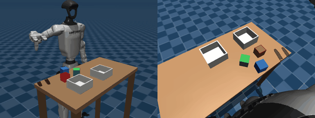
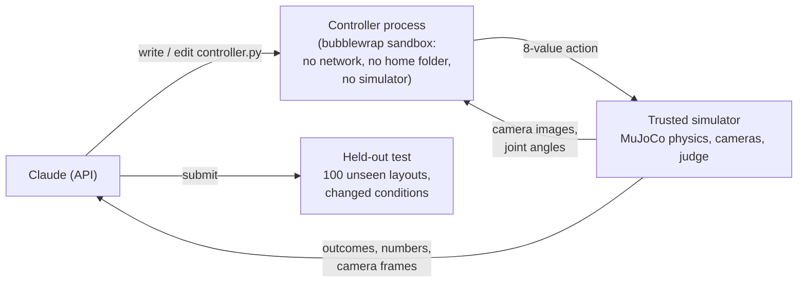
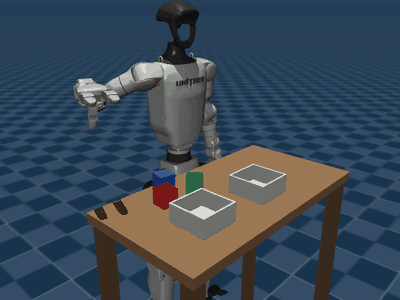
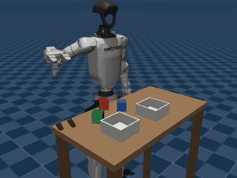
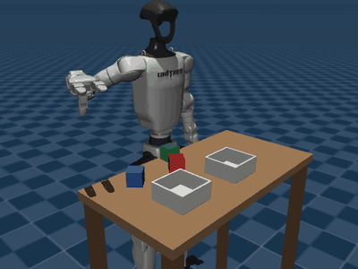

# dex-coder

**An AI agent writes, tests and fixes the controller for a humanoid robot hand: first from exact
object positions, then from its cameras alone. Every result is measured on layouts and conditions
the agent never saw, with the dollars it cost.**


<p align="center">
  
</p>
<p align="center"><em>A controller Claude Opus 5.5 wrote from the cameras alone, on a test layout it
never saw. Left: the scene. Right: the robot's head camera; it and the wrist camera are everything
the controller gets about the cubes.</em></p>

> **Built on [humanoid-vla](https://github.com/ApurvK032/humanoid-vla)**, my project for
> language-conditioned manipulation with a simulated Unitree G1 and Dex3 hand. dex-coder reuses its
> MuJoCo scene, tasks, outcome judge and hand-tuned scripted expert (pinned as a submodule) and asks
> a different question: instead of training a policy, can an LLM agent *program* one?

## Highlights

- **From the cameras alone, 5 of 5 runs succeeded.** Each time, Claude Opus 5.5 wrote a controller
  that sorts 92-100% of unseen layouts under every condition, against 99-100% for a camera-based
  reference, for about $2.60 and 17 minutes per run.
- **Robust to conditions it never saw.** Different lighting with shadows, a noisy, slightly
  mis-calibrated and delayed camera, heavier and slippery cubes, weaker motors: no camera
  controller lost more than 3 points.
- **On par with a human-written expert.** With exact positions, 6 of 9 sort controllers cannot be
  told apart from the hand-tuned expert in any condition.
- **Iteration is what makes it work.** The agent's last controller beat its first in 25 of 27 runs,
  by 44 points on average.
- **Cheat-proof by construction.** In the camera study the controller runs in a sandboxed process
  that holds no simulator and never receives object positions.
- 32 runs and a pilot, **$93.67** of API spend in total.

## How it works



1. **The agent gets an interface, not a solution.** Claude is told the robot's interface (joints,
   cameras, the 8-value action: 7 arm joint targets and a hand closure at 25 Hz) and the rules, but
   none of the expert's design knowledge: no reachable regions, grasp headings, waypoints or timings
   ([prompt](src/dexcoder/prompts.py)).
2. **It works like an engineer.** With a fixed budget of turns it writes `controller.py`, runs it on
   practice layouts, reads outcomes, time series and camera frames, saves observations to develop
   perception offline, edits and resubmits.
3. **It is scored on what it never saw.** The submitted controller runs on 100 unseen layouts under
   each held-out condition, next to a reference, on humanoid-vla's judge.
4. **Every number is protected and reproducible.** Agent-written code only runs in a sandbox. With
   exact poses, every episode is replayed from its recorded actions by a trusted process; with
   cameras, the controller lives in a separate process that only ever receives the observation.
   Every result file records the commit that produced it, and every API call goes to a cost
   ledger.

## Results

### Study 2: from the cameras alone

The controller gets the head and wrist camera images (320 x 240, colour and depth), the cameras'
calibrated poses, its joint angles and the instruction (for example "Put the red block in the
right bin."). It never gets cube positions. Opus 5.5, five runs, the sort task.

| Run | Nominal | Heavy & slippery | Weak motors | Lighting | Noisy camera | API cost |
|---|---|---|---|---|---|---|
| 1 | 95% | 94% | 100% | 98% | 98% | $2.41 |
| 2 | 97% | 100% | 97% | 95% | 99% | $2.44 |
| 3 | 100% | 97% | 99% | 100% | 99% | $2.68 |
| 4 | 100% | 98% | 100% | 100% | 100% | $2.79 |
| 5 | 93% | 94% | 95% | 94% | 92% | $2.90 |
| Reference | 99% | 100% | 100% | 99% | 99% | - |

*Success on 100 held-out layouts per condition. Reference: humanoid-vla's scripted expert planning
from cubes found by colour and depth in the first head image.*

- **Three of the five controllers cannot be told apart from the reference** in any condition
  (Fisher's exact test); runs 1 and 5 are a few points lower in at least one.
- **Failures are rare and benign:** 66 of 2,500 held-out episodes, 49 timeouts and 17 dropped cubes;
  none moved the wrong cube or used the wrong bin.
- **What Claude built, without being told how.** Every controller back-projects the head camera's
  depth image into 3D with the calibration, finds the cubes by colour and height, fits each top
  face for position and rotation, and plans grasps with inverse kinematics and collision checks on
  its private robot model. The designs differ: runs 1, 2 and 4 check with the cameras whether the
  grasp or the placement worked and retry if not; run 2 re-measures the cube with the wrist camera
  before grasping; run 4 re-calibrates its head camera from the bins' walls and tested its
  perception against simulated lighting, noise and calibration errors on its own. Run 3, by its
  notes, does none of this and still scored 97-100%. Code: [results/controllers](results/controllers).


### Study 1: from exact positions

Controllers read the cubes' exact poses from the simulator. Three tasks, three Claude models
(Fable 5.1, Opus 5.5, Sonnet 5.5), three runs each.

| Sort a cube into a bin | Stack two cubes | Two cubes into one bin |
|---|---|---|
|  |  |  |

1. **Testing and fixing is what makes the controllers work.** On the same held-out layouts, the
   last controller version beat the first in 25 of 27 runs, by 44 points on average (sort 44% to
   94%, stack 29% to 89%, two cubes 3% to 27%; sign-flip p < 0.001).
2. **Noisy, delayed sensing is the weak spot; changed physics mostly is not.** Each controller
   against itself: noisy cube positions lowered success in 21 of 27 controllers (mean -7 points,
   p < 0.001), mostly where placement must be precise (stacking -10, all nine worse; two cubes -10;
   sorting -1). Heavy, slippery cubes had no clear effect (p = 0.47); weak motors cost about
   2 points.
3. **Claude can match a human-written expert.** 6 of the 9 sort controllers cannot be told apart
   from humanoid-vla's scripted expert (99-100%) in any of the four conditions.
4. **Failures are unfinished tasks, not wrong actions.** Of 10,800 held-out episodes, 12 moved the
   wrong cube or used the wrong bin; 91% of failures were timeouts.
5. **Practice scores predicted held-out scores.** Where the final version had been through the
   trial tool, practice and held-out success differed by under 1 point on average: no tuning to
   the practice layouts.
6. **No run reached around the interface.** Every scored episode replayed exactly from its
   recorded actions (no mismatch in 11,200 episodes, pilot included) and the code scan flagged
   nothing.

Three runs per model are too few to rank the models (the same model on the same task ranged from
19% to 87%), so no ranking is claimed; see [D-6](docs/DECISIONS.md). Every run's numbers are in
[results/SUMMARY.md](results/SUMMARY.md).


### Cost

| Study | Runs | Models | API spend | Per run |
|---|---|---|---|---|
| 1: exact positions | 27 + pilot | Fable 5.1, Opus 5.5, Sonnet 5.5 | $80.45 | $1.02-10.26 |
| 2: cameras only | 5 | Opus 5.5 | $13.22 | $2.41-2.90 |
| **Total** | **32 + pilot** | | **$93.67** | |

Simulation, rendering and scoring run locally on one RTX 4070 and cost nothing; the API is billed
only for the text the agent reads and writes. Camera images never go to the model unless it asks
to look at a frame.

## Reproduce

Linux x86_64 with an NVIDIA GPU (EGL rendering), Python 3.12 and bubblewrap.

```bash
git clone --recurse-submodules https://github.com/ApurvK032/dex-coder.git && cd dex-coder
python3 -m venv .venv && .venv/bin/pip install -e ".[dev]" && .venv/bin/pip install --no-deps -e third_party/humanoid-vla
.venv/bin/python third_party/humanoid-vla/scripts/fetch_assets.py
.venv/bin/python -m pytest
```

On Ubuntu 24.04, unprivileged bubblewrap needs Ubuntu's `bwrap-userns-restrict` AppArmor profile,
which ships (disabled) in the `apparmor-profiles` package:

```bash
sudo install -m 644 /usr/share/apparmor/extra-profiles/bwrap-userns-restrict /etc/apparmor.d/
sudo apparmor_parser -r /etc/apparmor.d/bwrap-userns-restrict
```

| Step | Command | API cost |
|---|---|---|
| References | `.venv/bin/python scripts/evaluate_runs.py --reference --vision-reference` | none |
| One run, exact positions | `.venv/bin/python scripts/run_agent.py --run-id R --kind sort --model opus --max-usd 6` | up to the cap |
| One run, cameras only | `.venv/bin/python scripts/run_agent.py --run-id R --kind sort --model opus --mode vision --max-turns 50 --max-usd 8` | up to the cap |
| Many runs | `.venv/bin/python scripts/run_campaign.py configs/campaign.json --parallel 4` | up to `--cap` |
| Held-out evaluation | `.venv/bin/python scripts/evaluate_runs.py --runs all` | none |
| Tables and figures | `.venv/bin/python scripts/report.py` | none |

The API key is read from `ANTHROPIC_API_KEY` (or `~/.config/dexcoder/anthropic_api_key`). Runs stop
at a per-run and a global spend cap; create `outputs/STOP` to stop every run before its next call.

## Repository layout

| Path | What |
|---|---|
| `src/dexcoder/agent.py`, `prompts.py` | The agent loop, its tools and instructions |
| `src/dexcoder/tasks.py` | Tasks, layouts, judges and held-out physics conditions |
| `src/dexcoder/robot_api.py`, `worker.py`, `trials.py` | Study 1: what a controller gets, sandboxed episodes, trusted replay |
| `src/dexcoder/vision.py`, `vworker.py` | Study 2: trusted physics and cameras, and the controller's own process |
| `src/dexcoder/sandbox.py` | The bubblewrap sandbox for agent-written code |
| `src/dexcoder/evaluate.py`, `ledger.py` | Held-out scoring and the API cost ledger |
| `scripts/` | Running agents, scoring, statistics, figures, GIFs |
| `results/` | Scores with provenance, every final controller, run summaries, full agent transcripts |
| `docs/DECISIONS.md` | Every non-obvious design decision |
| `third_party/humanoid-vla` | Simulator, tasks, judge and human reference (submodule, pinned) |

## Limitations

- **Simulation only.** All conditions are MuJoCo; there is no second engine and no real robot.
- **Small samples.** Study 2 is five runs of one model on one task; study 1 is three runs per task
  and model. Each controller's own score is precise (100 layouts per condition); how often a run
  produces a good controller is not.
- **An easy scene for perception.** Three saturated red, green and blue cubes on a plain table,
  fixed bins and calibrated cameras. Clutter, unknown objects and real images are untested.
- **Some human design is built in.** The one-value hand synergy and the grasp site come from
  humanoid-vla, where a person tuned them.
- **One setup per study:** one prompt, effort `high`, fixed turn limits (40, and 50 with cameras).

## Related work

LLMs that write robot code are established: Code as Policies (Liang et al., 2022) generates policy
code from language, and Eureka (Ma et al., 2023) writes reward functions for reinforcement
learning. dex-coder's contribution is the measurement: contact-rich grasping with a humanoid hand,
from exact state and from cameras alone, a direct comparison with a hand-written expert on the
same judge, held-out physics, lighting and sensing, an isolation design in which the controller
cannot see the simulator, and the dollar cost of every result.
