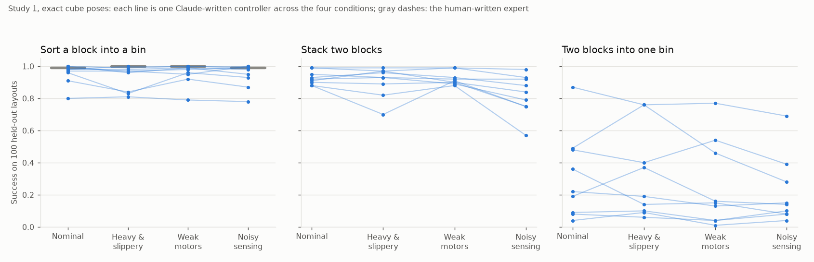
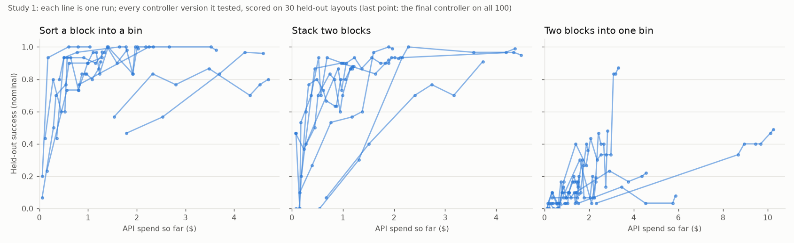
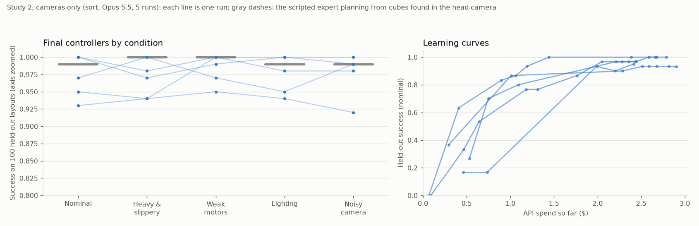

# Results

API spend, all calls including pilots: $93.67 in 1350 calls (Fable 5.1 $46.22, Opus 5.5 $35.53, Sonnet 5.5 $11.92).

## Study 1: controllers read exact cube poses

27 runs: three tasks, three models, three runs each ($78.71). Three runs per model are too few to compare models, so no per-model averages are given; the per-run table below is raw data.

### Testing and fixing is what makes the controllers work

First and last controller version each run tested, scored on the first 30 held-out layouts (nominal).

| Task | First version (mean) | Last version (mean) | Runs where the last was better |
|---|---|---|---|
| sort | 44% | 94% | 9 of 9 |
| stack | 29% | 89% | 9 of 9 |
| pair | 3% | 27% | 7 of 9 |

All runs: mean gain +44 points, better in 25 of 27, sign-flip p < 0.001.

### Changed conditions, each controller against itself

Change in held-out success from the nominal condition, per controller (100 layouts each).

| Condition | All 27: mean change | Worse / better / same | p | Sort | Stack | Two blocks |
|---|---|---|---|---|---|---|
| Heavy & slippery | -1.4 | 15 / 9 / 3 | 0.471 | -2.7 | -2.1 | +0.6 |
| Weak motors | -2.1 | 15 / 5 / 7 | 0.024 | -0.1 | -0.4 | -5.8 |
| Noisy sensing | -7.1 | 21 / 3 / 3 | < 0.001 | -1.1 | -10.4 | -9.7 |

### Sort controllers against the human-written expert

6 of 9 sort controllers are not distinguishable from humanoid-vla's scripted expert in any of the four conditions (Fisher's exact test, 5%, 100 layouts each): sort_fable_1, sort_opus_1, sort_opus_2, sort_opus_3, sort_sonnet_1, sort_sonnet_3. The others are lower in at least one.

### How controllers fail

Of 10800 held-out episodes, 3182 failed: timeouts 2897 (91%), dropped 267, wrong block or bin 12, controller errors 6, integrity mismatches 0. Code flags: 0.

### Practice scores against held-out scores

In the 16 runs whose final version went through run_trials, its practice success minus its held-out success averaged +0.6 points (sign-flip p 0.865): no sign of tuning to the practice layouts. In 8 of the 22 submitted runs, the submitted version was never run through run_trials after its last edit.

### Reference

humanoid-vla's scripted expert (human-written, reads true poses), sort: Nominal 99%, Heavy & slippery 100%, Weak motors 100%, Noisy sensing 99%.

### Every run

| Run | Task | Model | End | Turns | Versions | $ | Nominal | Heavy & slippery | Weak motors | Noisy sensing | Failures on nominal | Code flags |
|---|---|---|---|---|---|---|---|---|---|---|---|---|
| pair_fable_1 | pair | Fable 5.1 | submitted | 39 | 9 | 10.26 | 49% | 76% | 46% | 28% | timeout 47, dropped 4 | - |
| pair_fable_2 | pair | Fable 5.1 | turn limit | 40 | 18 | 4.56 | 22% | 19% | 13% | 15% | timeout 75, dropped 3 | - |
| pair_fable_3 | pair | Fable 5.1 | turn limit | 40 | 13 | 5.87 | 8% | 6% | 4% | 8% | timeout 83, dropped 9 | - |
| pair_opus_1 | pair | Opus 5.5 | submitted | 40 | 27 | 3.31 | 87% | 76% | 77% | 69% | timeout 11, dropped 2 | - |
| pair_opus_2 | pair | Opus 5.5 | submitted | 37 | 27 | 2.31 | 19% | 37% | 16% | 14% | timeout 73, dropped 8 | - |
| pair_opus_3 | pair | Opus 5.5 | submitted | 40 | 27 | 2.83 | 48% | 40% | 54% | 39% | timeout 51, dropped 1 | - |
| pair_sonnet_1 | pair | Sonnet 5.5 | turn limit | 40 | 32 | 1.43 | 4% | 9% | 1% | 4% | timeout 96 | - |
| pair_sonnet_2 | pair | Sonnet 5.5 | submitted | 39 | 40 | 1.95 | 36% | 14% | 15% | 8% | timeout 64 | - |
| pair_sonnet_3 | pair | Sonnet 5.5 | submitted | 40 | 37 | 1.54 | 9% | 10% | 4% | 10% | timeout 91 | - |
| sort_fable_1 | sort | Fable 5.1 | submitted | 40 | 9 | 3.63 | 98% | 100% | 100% | 100% | dropped 2 | - |
| sort_fable_2 | sort | Fable 5.1 | submitted | 40 | 14 | 4.70 | 80% | 81% | 79% | 78% | timeout 12, dropped 8 | - |
| sort_fable_3 | sort | Fable 5.1 | submitted | 40 | 12 | 4.60 | 96% | 83% | 96% | 93% | timeout 2, dropped 2 | - |
| sort_opus_1 | sort | Opus 5.5 | submitted | 40 | 24 | 2.34 | 100% | 99% | 100% | 99% | - | - |
| sort_opus_2 | sort | Opus 5.5 | submitted | 40 | 27 | 1.80 | 98% | 98% | 99% | 95% | timeout 2 | - |
| sort_opus_3 | sort | Opus 5.5 | submitted | 39 | 24 | 2.03 | 99% | 97% | 98% | 99% | timeout 1 | - |
| sort_sonnet_1 | sort | Sonnet 5.5 | turn limit | 40 | 17 | 1.04 | 100% | 96% | 99% | 98% | - | - |
| sort_sonnet_2 | sort | Sonnet 5.5 | submitted | 39 | 22 | 1.26 | 91% | 84% | 92% | 87% | timeout 9 | - |
| sort_sonnet_3 | sort | Sonnet 5.5 | turn limit | 40 | 22 | 1.28 | 97% | 97% | 95% | 100% | dropped 2, timeout 1 | - |
| stack_fable_1 | stack | Fable 5.1 | submitted | 40 | 12 | 4.37 | 99% | 99% | 99% | 98% | dropped 1 | - |
| stack_fable_2 | stack | Fable 5.1 | submitted | 40 | 15 | 3.74 | 91% | 97% | 90% | 84% | timeout 6, dropped 3 | - |
| stack_fable_3 | stack | Fable 5.1 | submitted | 39 | 12 | 4.49 | 95% | 93% | 92% | 92% | dropped 3, timeout 2 | - |
| stack_opus_1 | stack | Opus 5.5 | submitted | 38 | 24 | 2.08 | 93% | 96% | 93% | 88% | timeout 5, dropped 2 | - |
| stack_opus_2 | stack | Opus 5.5 | submitted | 40 | 14 | 1.90 | 92% | 93% | 89% | 79% | timeout 6, dropped 2 | - |
| stack_opus_3 | stack | Opus 5.5 | submitted | 40 | 26 | 1.97 | 99% | 97% | 99% | 93% | timeout 1 | - |
| stack_sonnet_1 | stack | Sonnet 5.5 | submitted | 39 | 22 | 1.19 | 88% | 82% | 88% | 57% | timeout 8, dropped 4 | - |
| stack_sonnet_2 | stack | Sonnet 5.5 | submitted | 40 | 29 | 1.02 | 90% | 89% | 90% | 75% | timeout 7, dropped 3 | - |
| stack_sonnet_3 | stack | Sonnet 5.5 | submitted | 40 | 30 | 1.21 | 88% | 70% | 91% | 75% | timeout 6, dropped 6 | - |

The pilot ran with an earlier harness (scratch scripts could not import the controller) and is not part of the findings above:

| Run | Task | Model | End | Turns | Versions | $ | Nominal | Heavy & slippery | Weak motors | Noisy sensing | Failures on nominal | Code flags |
|---|---|---|---|---|---|---|---|---|---|---|---|---|
| pilot_opus_sort | sort | Opus 5.5 | submitted | 38 | 19 | 1.74 | 98% | 99% | 100% | 98% | dropped 1, timeout 1 | - |

## Study 2: cameras only

5 runs of Opus 5.5 on the sort task ($13.22). Controllers get head and wrist camera images (colour and depth), joint angles and the instruction; no cube poses (D-7).

| Condition | Lowest run | Highest run | Mean of runs | Reference |
|---|---|---|---|---|
| Nominal | 93% | 100% | 97% | 99% |
| Heavy & slippery | 94% | 100% | 97% | 100% |
| Weak motors | 95% | 100% | 98% | 100% |
| Lighting | 94% | 100% | 97% | 99% |
| Noisy camera | 92% | 100% | 98% | 99% |

Reference: humanoid-vla's scripted expert planning from cubes found by colour and depth in the first head image (written for this study to check that every condition can be solved from the cameras).

3 of 5 controllers are not distinguishable from the reference in any of the five conditions (Fisher's exact test, 5%): vision_sort_opus_2, vision_sort_opus_3, vision_sort_opus_4.

Largest drop from nominal under any changed condition: 3 points (vision_sort_opus_3).
Of 2500 held-out episodes, 66 failed: timeout 49, dropped 17.
Cost per run $2.41-2.90, 13-22 minutes; all 5 runs submitted.

### Every run

| Run | Task | Model | End | Turns | Versions | $ | Nominal | Heavy & slippery | Weak motors | Lighting | Noisy camera | Failures on nominal | Code flags |
|---|---|---|---|---|---|---|---|---|---|---|---|---|---|
| vision_sort_opus_1 | sort | Opus 5.5 | submitted | 49 | 23 | 2.41 | 95% | 94% | 100% | 98% | 98% | dropped 3, timeout 2 | - |
| vision_sort_opus_2 | sort | Opus 5.5 | submitted | 47 | 28 | 2.44 | 97% | 100% | 97% | 95% | 99% | timeout 2, dropped 1 | - |
| vision_sort_opus_3 | sort | Opus 5.5 | submitted | 48 | 39 | 2.68 | 100% | 97% | 99% | 100% | 99% | - | - |
| vision_sort_opus_4 | sort | Opus 5.5 | submitted | 49 | 25 | 2.79 | 100% | 98% | 100% | 100% | 100% | - | - |
| vision_sort_opus_5 | sort | Opus 5.5 | submitted | 50 | 39 | 2.90 | 93% | 94% | 95% | 94% | 92% | timeout 7 | - |

